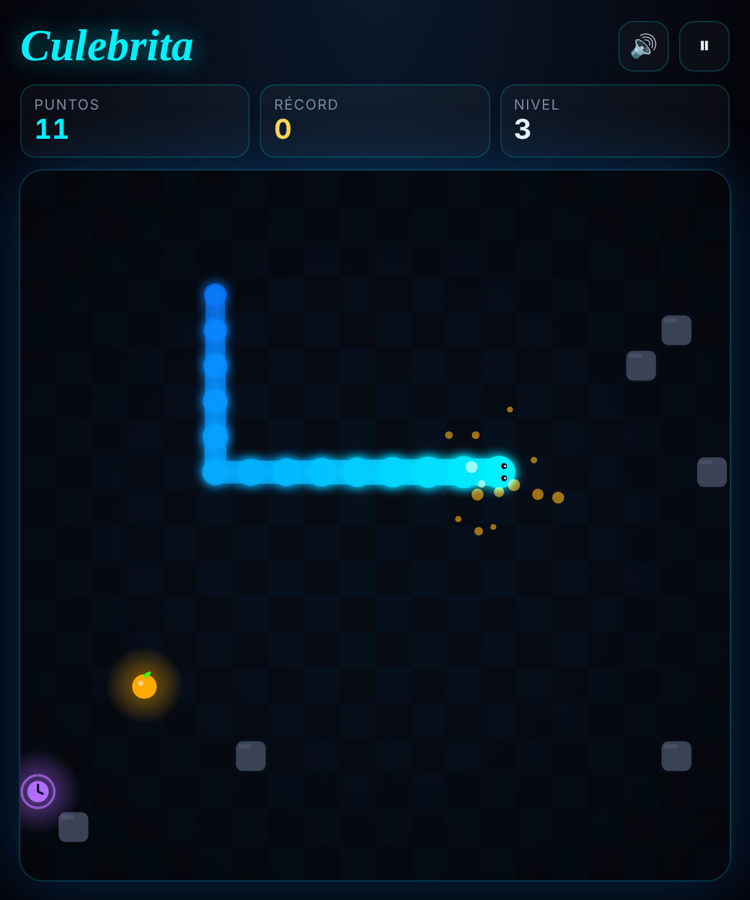

# Culebrita

La culebrita de toda la vida, con luces de neón, poderes y récord. Se juega en el navegador, en la compu con el teclado o en el cel con el dedo.

**[Jugar aquí](https://said1ojeda.github.io/Juego.Culebrita/)**

  

## Cómo se juega

Come la fruta para crecer y sumar puntos. Pierdes si chocas con la pared, con una piedra o con tu propia cola.

| | Qué hace |
|---|---|
| 🟠 **Fruta** | +1 punto y creces. Cada 5 frutas subes de nivel y todo va más rápido. |
| ⭐ **Estrella** | +5 puntos y creces el doble. Desaparece en 5 segundos, el anillo te dice cuánto le queda. |
| ⚡ **Turbo** | Por 5 segundos vas más rápido, pero cada fruta vale doble. |
| ⏱ **Reloj** | Por 5 segundos todo va más lento. Sirve para salir de un apuro. |

### Dificultades

- **Tranquilo**: lento, para agarrarle la onda.
- **Normal**: el de siempre.
- **Picante**: arranca más rápido y en cada nivel aparecen piedras nuevas en el tablero.

También se puede activar **Atravesar paredes**: sales por un lado y entras por el otro.

### Controles

| Acción | Teclado | Cel |
|---|---|---|
| Moverse | Flechas o `W A S D` | Deslizar el dedo sobre el tablero o la cruceta de abajo |
| Pausa | `P` o `Esc` | Botón ⏸ |
| Sonido | `M` | Botón 🔊 |
| Jugar otra vez | `Espacio` o `Enter` | Botón "Otra vez" |

El juego se pausa solo si cambias de pestaña o bloqueas el cel. El récord se guarda en el navegador, uno por cada dificultad.

## Correrlo en tu compu

Es un solo archivo, `index.html`, sin librerías ni instalaciones. Lo descargas y lo abres con doble clic.

## Cómo está hecho

HTML, CSS y JavaScript puro, dibujado en un `<canvas>`.

- **Un solo ciclo de juego** con `requestAnimationFrame` y paso fijo. La lógica avanza en pasos según la velocidad, pero se dibuja a 60 fps.
- **Movimiento suave**: la culebra se dibuja entre la posición anterior y la nueva, así no se mueve a brincos de cuadro en cuadro.
- **Cola de giros**: guarda hasta 3 teclas, para que las vueltas rápidas en U no se pierdan ni te hagan chocar contigo mismo.
- **El fondo se pinta una sola vez** en un canvas aparte y se copia en cada frame. Así va fluido también en celulares.
- **Pantallas de alta densidad**: el canvas se ajusta al `devicePixelRatio`, y en el cel y en pantallas retina se ve nítido.
- **Sonidos generados con Web Audio**, sin archivos de audio.
- **Partículas, temblor y destello** al comer y al perder.

### Qué se arregló de la primera versión

La primera versión era un solo HTML pegado en el README. Funcionaba, pero tenía estos problemas:

- Un comentario de CSS sin cerrar se comía las variables de color.
- Cada vez que reiniciabas se arrancaba **otro** ciclo de juego y se agregaba **otro** detector de teclas. Entre más jugabas, más rápido iba y peor respondía.
- La cuadrícula del fondo se volvía a dibujar entera en cada frame, con 625 degradados.
- No tenía controles táctiles, pausa ni récord.

## Licencia

MIT. Ver [LICENSE](LICENSE).
